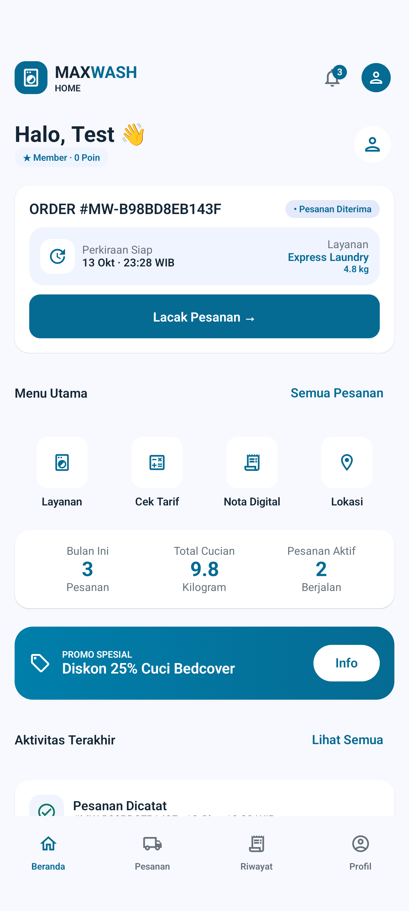
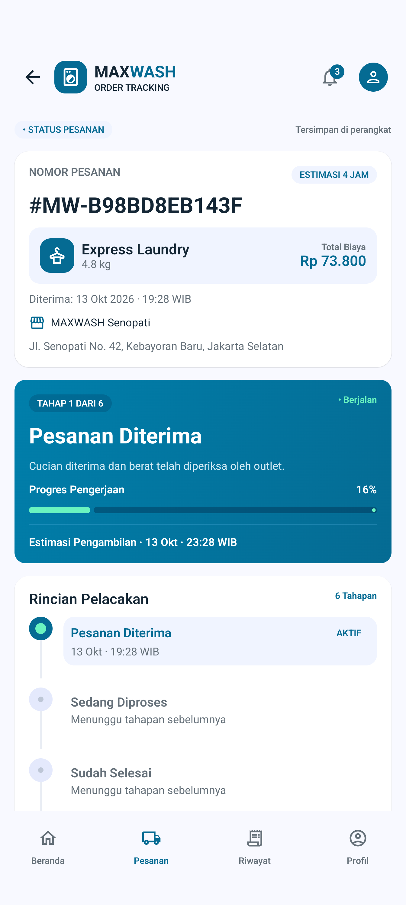

<h1>🧺 MAXWASH</h1>

<strong>Laundry Pintar &amp; Praktis</strong>

Pesan layanan laundry, atur penjemputan, dan pantau cucian dari genggaman.

📱 Android &nbsp; · &nbsp; 🎨 Jetpack Compose &nbsp; · &nbsp; 💾 Room

  <a href="#fitur">Fitur</a> &nbsp; · &nbsp;
  <a href="#tampilan">Tampilan</a> &nbsp; · &nbsp;
  <a href="#alur">Alur Pemesanan</a> &nbsp; · &nbsp;
  <a href="#teknologi">Teknologi</a> &nbsp; · &nbsp;
  <a href="#menjalankan">Cara Menjalankan</a>

---

## 👋 Tentang MAXWASH

MAXWASH adalah aplikasi Android untuk pelanggan laundry yang membantu pengguna memilih layanan, membuat pesanan, dan memantau proses pencucian dalam satu aplikasi. Pengguna dapat mengatur penjemputan ke lokasi, melihat rincian biaya, serta melacak pesanan dari Beranda.

Aplikasi ini dikembangkan sebagai prototipe untuk mata kuliah IF570L. Data akun dan pesanan disimpan secara lokal di perangkat menggunakan Room, sedangkan pembayaran disimulasikan untuk memperlihatkan alur pemesanan.

### 🎯 Tujuan aplikasi

MAXWASH memudahkan pelanggan mengelola kebutuhan laundry tanpa harus mencatat pesanan secara terpisah. Informasi layanan, estimasi biaya, outlet, dan status cucian dapat dilihat melalui aplikasi dengan tampilan yang konsisten.

---

## ✨ Fitur utama

| Fitur | Yang dapat dilakukan pelanggan |
| --- | --- |
| 🔐 **Registrasi & Login** | Membuat akun dan masuk menggunakan email atau nomor handphone. |
| 🏠 **Beranda** | Melihat pesanan aktif, estimasi selesai, statistik cucian, promo, dan aktivitas terakhir. |
| 🚚 **Pemesanan Laundry** | Mengatur penjemputan ke lokasi, outlet, jadwal, layanan, parfum, tambahan, catatan, dan estimasi berat. |
| 💳 **Konfirmasi Pembayaran** | Memeriksa tagihan, menggunakan kode promo, dan memilih QRIS, virtual account, atau bayar di outlet. |
| 🧾 **Nota Digital** | Melihat nota transaksi lunas, menggulir nota sebelumnya, dan menyimpan nota sebagai PDF melalui pemilih folder Android. |
| 📍 **Order Tracking** | Melihat nomor pesanan, layanan, berat, biaya, outlet, estimasi pengambilan, dan tahapan pengerjaan. |
| 📋 **Pesanan & Riwayat** | Mencari pesanan dan menyaring pesanan aktif atau selesai. |
| 🔔 **Notifikasi** | Membaca informasi pesanan dan menandainya sebagai sudah dibaca. |
| 👤 **Profil Pelanggan** | Mengatur data diri, alamat, parfum favorit, catatan khusus, preferensi notifikasi, dan outlet langganan. |
| 🏪 **Lokasi Outlet** | Melihat alamat dan jam operasional serta membuka petunjuk arah. |
| 🗺️ **Peta Penjemputan** | Melihat peta interaktif dan perkiraan lokasi alamat atau outlet melalui TomTom. |

## 📱 Tampilan aplikasi

| 🏠 Beranda | 📍 Order Tracking |
| :---: | :---: |
|  |  |
| Ringkasan pesanan aktif dan akses cepat ke layanan. | Rincian pesanan, estimasi selesai, dan progres cucian. |

---

## 🔄 Alur penggunaan

> 🏠 **Beranda** → 🚚 **Penjemputan** → 🧺 **Pilih Layanan** → 💳 **Bayar** → 🏠 **Beranda** → 📍 **Lacak Pesanan**

1. Daftar akun melalui halaman Registrasi, lalu masuk ke aplikasi.
2. Lengkapi alamat dan preferensi melalui halaman Profil.
3. Pilih menu **Layanan** di Beranda.
4. Tentukan metode penjemputan, alamat atau outlet, dan jadwal yang diinginkan.
5. Pilih layanan, parfum, tambahan, serta masukkan estimasi berat cucian.
6. Periksa rincian tagihan, gunakan kode promo jika tersedia, dan pilih metode pembayaran.
7. Tekan **Bayar Sekarang**. Pesanan disimpan dan aplikasi kembali ke Beranda. QRIS serta virtual account dianggap lunas dalam simulasi; Bayar di Outlet menunggu pembayaran di outlet.
8. Tekan **Lacak Pesanan** untuk membuka Order Tracking dari pesanan tersebut.

### Nota Digital dan PDF

Buka **Beranda → Nota Digital** untuk melihat seluruh nota lunas, dari yang terbaru. Gulir ke bawah untuk nota sebelumnya. Tombol **Nota Digital** di Pesanan, Riwayat, dan rincian pesanan membuka nota pesanan yang dipilih. Tekan **Unduh / Simpan Nota PDF** untuk memilih nama serta lokasi penyimpanan; membatalkan pemilih berkas tidak membuat unduhan.

Nota menyimpan identitas outlet dan pelanggan, nomor nota/pesanan, waktu transaksi WIB, layanan, berat estimasi, tarif, parfum, tambahan deterjen, promo, metode pembayaran, serta total saat checkout. Data transaksi tetap sama setelah profil atau katalog berubah. Status pengambilan mengikuti status dan riwayat pesanan saat nota dilihat atau diunduh. PDF mendukung beberapa halaman untuk rincian yang panjang.

QRIS dan virtual account dianggap lunas dalam simulasi prototipe. **Bayar di Outlet** tetap belum lunas sampai pembayaran tercatat. Pesanan lama atau catatan manual yang tidak memiliki rincian pembayaran tidak diterbitkan nota lunas. Nota dan PDF mencantumkan transaksi simulasi karena belum ada payment gateway. Database versi 2 menambahkan rekaman transaksi melalui migrasi yang mempertahankan data versi 1.

## 🧺 Layanan laundry

| Layanan | Pilihan perawatan |
| --- | --- |
| 👕 **Cuci Kering Lipat** | Pencucian, pengeringan, dan pelipatan pakaian. |
| 🧼 **Cuci & Setrika** | Pencucian dan penyetrikaan pakaian. |
| ⚡ **Laundry Express** | Layanan laundry dengan estimasi pengerjaan lebih cepat. |
| ♨️ **Setrika Saja** | Perapian pakaian melalui penyetrikaan. |

Tarif dan estimasi pengerjaan mengikuti katalog layanan di aplikasi. Biaya dihitung berdasarkan estimasi berat, tambahan deterjen, dan potongan promo yang dipilih.

## 📦 Tahapan pesanan

Order Tracking menampilkan enam tahapan laundry:

| Tahap | Status |
| :---: | --- |
| 1 | 📥 Pesanan Diterima |
| 2 | ⚙️ Sedang Diproses |
| 3 | ✅ Sudah Selesai |
| 4 | 📦 Sudah Dipacking |
| 5 | 🏪 Siap Diambil |
| 6 | 🤝 Sudah Diambil |

Pesanan baru dimulai pada tahap **Pesanan Diterima**. Pelanggan dapat melihat status dan riwayat tahapannya melalui halaman pelacakan.

---

## 🛠️ Teknologi

| Teknologi | Penggunaan |
| --- | --- |
| Kotlin | Bahasa pemrograman aplikasi |
| Jetpack Compose dan Material 3 | Tampilan dan komponen antarmuka |
| Navigation Compose | Navigasi antarhalaman |
| ViewModel, Flow, dan coroutine | Pengelolaan data dan state aplikasi |
| Room / SQLite | Penyimpanan lokal akun, profil, pesanan, dan notifikasi |
| TomTom dan Leaflet | Peta interaktif dan pencarian lokasi alamat |

## 💾 Penyimpanan data dan cakupan prototipe

Akun, profil, pesanan, notifikasi, dan sesi login tetap tersimpan ketika aplikasi ditutup dan dibuka kembali. Logout mengakhiri sesi tanpa menghapus akun atau pesanan. Setiap akun memiliki daftar pesanannya sendiri.

Pembayaran belum terhubung ke payment gateway dan tidak melakukan penagihan nyata. Pesanan disimpan di perangkat dan belum dikirim ke sistem operasional outlet. Status laundry tidak berubah otomatis, serta belum tersedia sinkronisasi data antarperangkat atau push notification.

Fitur utama yang memakai data lokal dapat digunakan tanpa internet. Peta penjemputan dan pencarian alamat membutuhkan koneksi internet serta API key TomTom. Menghapus data aplikasi atau melakukan uninstall akan menghapus data lokal.

## 🚀 Menjalankan aplikasi

1. Buka proyek MAXWASH di Android Studio.
2. Gunakan Android SDK 37 dan JDK bawaan Android Studio sesuai konfigurasi proyek.
3. Tunggu sinkronisasi Gradle selesai.
4. Untuk menggunakan peta, tambahkan `TOMTOM_API_KEY=API_KEY_ANDA` ke `local.properties`. Key memerlukan akses TomTom Orbis Map Display dan Geocoding.
5. Jalankan aplikasi pada emulator atau perangkat Android dengan API level 27 atau lebih baru.
6. Buat akun melalui Registrasi untuk mulai menggunakan aplikasi.

---

## 👥 Anggota kelompok

| Nama | NIM |
| --- | --- |
| Michael | 00000106013 |
| Kevin Tanar | 00000105724 |
| Chrissander A.G | 00000106640 |
| Inocentius Noel P | 00000106169 |
